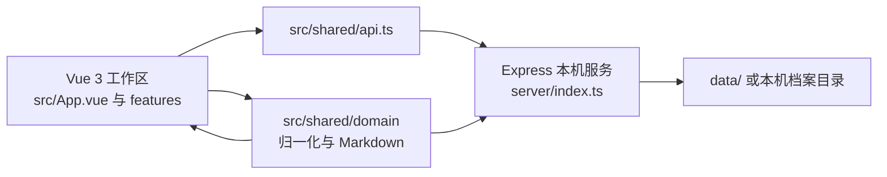

# 项目结构拆解

本文面向维护者和贡献者，说明故事时间线工具的运行边界、代码职责、数据流和验证入口。用户的故事档案、图鉴和本机设置属于运行时数据，不应写入仓库。

## 1. 项目目标与运行边界

项目是一个本机运行的故事编辑器，提供以下能力：

- 管理多个故事档案、事件、线路、阶段和主要人物基础数据。
- 以时间线视图按阶段、月份、日期和事件展示故事顺序。
- 以时间流视图按主线与分支线路对齐同一天事件。
- 在事件中保存人物当时的穿着、身体状态和其他事件档案。
- 维护独立的物品图鉴。
- 通过 Markdown 导入和导出故事与人物档案。
- 通过本机设置切换档案目录，并以快捷方式启动生产服务。

前端由 Vue 3、TypeScript 和 Vite 构建。本机服务由 Node.js、Express 和 `tsx` 运行，只监听 `127.0.0.1`。开发模式由 Vite 提供前端、Express 提供 API。生产模式由同一个 Express 服务提供 `dist/` 静态文件和 API。

## 2. 整体架构



### 前端层

`src/main.ts` 创建 Vue 应用并加载全局样式。`src/App.vue` 负责跨页面状态和工作流编排，包括当前故事、视图切换、保存状态、阶段和月份折叠、Markdown 文件选择以及快捷键。

### 业务功能层

`src/features/` 按用户任务拆分 Vue 组件。组件通过 props 接收故事数据，通过 emits 把编辑意图交回 `App.vue`，不直接访问文件系统。

### 共享层

`src/shared/` 放置所有功能共用的类型、API 客户端、领域归一化、Markdown 解析和通用弹窗/表单组件。归一化逻辑同时被前端和服务端使用，保证旧数据、接口数据和导入数据进入界面前具有相同结构。

### 本机服务层

`server/index.ts` 负责目录发现、JSON 读写、档案目录切换、图鉴 API 和生产静态文件。写入使用临时文件再重命名，避免保存过程中留下半截 JSON。

## 3. 目录与模块职责

```text
src/
  main.ts                         Vue 应用入口
  App.vue                         全局状态与工作流编排
  features/
    stories/
      StorySidebar.vue            故事列表、选择、新建、重命名、删除、侧栏折叠
      useStoryArchive.ts          故事加载、保存和列表状态
    events/EventModal.vue         事件编辑、人物档案、线路/分支关联
    timeline/
      TimelineBoard.vue           阶段-月份-事件时间线
      TimelineFlowBoard.vue       主线/分支时间流
      StageSettingsModal.vue      阶段范围设置
    people/PeopleBoard.vue        人物基础数据档案
    compendium/CompendiumBoard.vue 物品图鉴
  shared/
    types.ts                      故事、事件、人物和图鉴类型
    api.ts                        浏览器到本机服务的 API 封装
    composables/
      useAutoSave.ts              防抖自动保存与串行保存队列
    domain/normalize.ts           默认值、旧数据兼容、罩杯计算
    domain/timeline.ts            分支层级计算
    domain/markdown.ts             Markdown 导入解析与导出序列化
    components/                   弹窗、身体数据表单、本机设置
  styles/                         设计令牌与应用样式
server/index.ts                   本机 API 与生产静态服务
scripts/
  migrate-legacy-data.ts          旧 data 目录幂等迁移
  import-markdown.ts              Markdown 命令行导入
  start-timeline.ps1              快捷方式启动器
  install-timeline.ps1            Windows 安装脚本
  update-shortcut-icon.ps1        图标生成与快捷方式更新
tests/
  unit/                           领域、导入和迁移测试
  e2e/run.mjs                     构建后的浏览器验收
docs/                             数据格式与架构文档
data/.gitkeep                     本地数据目录占位文件
```

旧版单 HTML 文件和本机技能配置不参与构建，并由 `.gitignore` 排除。

## 4. Vue 组件关系

```text
App.vue
├─ StorySidebar
│  └─ 故事选择、新建、重命名、删除、本机设置、侧栏折叠
├─ 视图标签
│  ├─ TimelineBoard
│  │  └─ StageSettingsModal
│  ├─ TimelineFlowBoard
│  ├─ PeopleBoard
│  │  └─ BodyDataForm
│  └─ CompendiumBoard
├─ EventModal
│  └─ BodyDataForm × 当前事件人物
├─ LocalSettingsModal
└─ ModalShell
```

故事、事件、人物和阶段保存最终由 `App.vue` 调用 `useStoryArchive` 的保存入口。图鉴使用独立的图鉴 API。子组件通过事件回传用户操作或编辑数据，由工作区集中协调持久化，避免组件各自访问文件系统。

## 5. 核心数据结构

`StoryArchive` 是故事档案的根对象：

```ts
interface StoryArchive {
  storyId: string
  storyName: string
  events: TimelineEvent[]
  branches: TimelineBranch[]
  mainCharacters: TimelinePerson[]
  semesters: StoryPeriod[]
  semesterGroups: StoryPeriodGroup[]
  savedAt: string
  uiState?: Record<string, unknown>
}
```

`TimelineEvent` 保存日期、时段、正文、地点、摘要、人物名单、事件人物档案、顺序和所属线路。`TimelineBranch` 保存线路名称和可选的父事件。`TimelinePerson` 保存主要人物基础数据，包括身高、上胸围、下胸围、腰围、臀围、尺寸和备注。事件内的 `TimelineBodyData` 保存该事件时刻的人物状态。

人物罩杯是派生值。人物基础数据使用上胸围和下胸围计算，事件人物档案使用事件胸围和人物基础数据的下胸围计算。算法集中在 `src/shared/domain/normalize.ts`，当前保留旧版差值表和边界处理。用户不能直接把罩杯作为独立输入保存。

图鉴是独立的 `CompendiumItem[]`，由本机服务写入 `compendium.json`，不会混入故事 JSON。

## 6. 故事加载与保存流程

1. `App.vue` 挂载后读取 `/api/settings`、`/api/stories` 和 `/api/compendium`。
2. 选择故事后调用 `/api/stories/:id`，服务端读取 JSON 并通过 `normalizeStory` 补全旧字段和默认值。
3. 编辑事件、人物或阶段时，子组件向上 emit，`App.vue` 生成新的故事对象。
4. `useAutoSave` 的深度 watch 发现故事快照变化后启动 700ms 防抖自动保存。
5. 自动保存和 `Ctrl+S` 都进入串行保存队列。保存请求进行中产生的新编辑会排在当前请求之后。
6. 保存响应只有在对应请求仍代表当前编辑时才回写故事对象。旧响应不会覆盖更新中的本地编辑。
7. 保存失败时保留当前编辑状态，并在顶部显示失败状态，下一次编辑或 `Ctrl+S` 仍可触发重试。

服务端更新故事时把文件命名为 `故事名_存档时间.json`。更新故事名称或保存时间改变文件名时，会删除同一 `storyId` 的旧文件。迁移脚本使用稳定 `storyId` 文件名写入目标目录，以便迁移去重。服务端读取时始终以 JSON 内的 `storyId` 作为身份。

## 7. 时间线与时间流

### 时间线视图

`TimelineBoard.vue` 先按事件日期和 `order` 正序排列，再把事件归入阶段。阶段按 `story.semesters` 的定义顺序显示，每个阶段内部按月份正序显示。没有阶段的事件进入“未分阶段”。

阶段标题始终是事件容器的一级标题。阶段折叠时显示阶段摘要和线路统计，展开时显示其月份和事件。应用加载时只展开最新事件所属阶段，其他阶段折叠。月份也默认只展开最新事件所属月份。

分支事件通过父事件所属线路递归计算缩进。事件卡通过 CSS 变量设置缩进距离，因此主线、一级分支和更深层分支在视觉上保持父子层级。月份内容使用 Vue transition 从上到下展开，事件详情以半透明悬浮层显示，避免覆盖主线阅读。

### 时间流视图

`TimelineFlowBoard.vue` 把主线和每条分支作为独立线路行，把可见日期作为横向时间轴。同一天同一线路的事件按 `time` 字段文本和 `order` 排序。一天有多个事件时默认只显示第一项，点击日期单元格后展开其余事件。

时间流同样根据事件日期匹配阶段，默认只展开最新事件所属阶段。展开或折叠阶段只影响显示状态，不修改故事数据。分支行提供删除线路入口，删除线路时事件保留并回到主线。

### 折叠状态边界

阶段和月份折叠状态属于当前界面状态，不写入用户故事内容。切换故事时根据新故事的最新事件重新初始化，避免旧故事的折叠状态污染当前故事。

## 8. 人物档案与事件档案

人物基础数据档案位于 `PeopleBoard.vue`，用于维护主要人物的默认身体数据。表单变化后 700ms 自动保存，并同步更新已有事件中对应的非 NPC 人物的胸围和罩杯。

事件编辑位于 `EventModal.vue`。事件中的人物列表决定人物档案表单，NPC 标记和穿着、状态、胸围等数据保存在该事件的 `peopleData`。打开事件时会从主要人物基础数据同步默认胸围和罩杯，提交时再次计算派生罩杯。

## 9. Markdown 导入与导出

Markdown 格式定义在 [`story-format.md`](story-format.md) 和 [`branch-format.md`](branch-format.md)。

- 界面导出故事时输出主线、分支、事件元数据、正文和人物档案。
- 时间线和时间流中的事件导出按钮只输出单个事件 Markdown，也包含该事件的人物档案。
- 导入使用 `parseMarkdown`，按事件标题更新同名事件并保留原有 ID 和顺序。
- 分支章节可以声明分歧点。导入结束后再解析父事件引用，找不到父事件时保留事件并返回警告。
- 人物档案字段会转成 `peopleData`。有对应人物基础数据时，归一化会使用事件胸围和人物下胸围计算罩杯；没有匹配人物基础数据时保留 Markdown 提供的罩杯值。

命令行入口是：

```powershell
npm run import:md -- .\事件记录.md --story <故事ID>
```

## 10. 旧数据迁移与本机目录

`npm run migrate:data` 调用 `scripts/migrate-legacy-data.ts`。脚本扫描旧 `data/` 下的故事 JSON，归一化后写入目标目录的 `stories/`，按稳定 `storyId` 去重，已存在档案不会覆盖。物品图鉴迁移到目标目录的 `compendium.json`，同时生成 `migration-report.txt`。

服务默认使用项目内 `data/`。本机设置写入根目录的 `.timeline-settings.json`，服务启动时读取其中的绝对路径。设置新目录时，服务先复制旧目录中的故事和图鉴，再切换当前目录。无效或不存在的配置目录会回退到项目 `data/`。

本机 API 主要端点如下：

| 方法 | 路径 | 用途 |
| --- | --- | --- |
| `GET` | `/api/health` | 检查服务和当前档案目录 |
| `GET` | `/api/settings` | 读取档案目录 |
| `PUT` | `/api/settings` | 修改档案目录并迁移可复制数据 |
| `GET` | `/api/stories` | 获取故事摘要列表 |
| `GET` | `/api/stories/:id` | 读取完整故事 |
| `POST` | `/api/stories` | 新建故事 |
| `PUT` | `/api/stories/:id` | 保存故事 |
| `DELETE` | `/api/stories/:id` | 删除故事 |
| `GET` | `/api/compendium` | 读取图鉴 |
| `PUT` | `/api/compendium` | 保存图鉴 |

## 11. Windows 快捷方式与安装

`npm run install:windows` 执行 `scripts/install-timeline.ps1`。脚本安装依赖、构建应用、确认 PowerShell 7 和 Node.js 可用，然后创建桌面快捷方式 `故事时间线.lnk`。

快捷方式调用 `scripts/start-timeline.ps1`。启动器会在 `127.0.0.1:4174` 检查现有服务，只有其报告的数据目录与快捷方式安装目录下的 `data/` 匹配时才复用，否则会重启服务，随后打开浏览器。

快捷方式图标存放在 `assets/story-timeline.ico`。`npm run shortcut:icon` 调用 `scripts/update-shortcut-icon.ps1`，把桌面上的源图生成多尺寸 ICO，并更新现有快捷方式的图标引用。

## 12. 测试与验收

```powershell
npm test             # Vitest 单元测试
npm run build        # vue-tsc 类型检查和 Vite 构建
npm run test:e2e     # 构建后启动本机服务并运行 Playwright 验收
```

单元测试覆盖归一化、旧版罩杯算法、Markdown 事件/分支/人物档案导入导出、CLI 导入、迁移幂等性、嵌套分支层级和保存队列竞态。E2E 测试覆盖事件编辑、同日事件顺序、阶段和月份折叠、人物数据、图鉴、自动保存、快捷键和窄屏工作区。

## 13. Git 数据边界

仓库只提交源码、测试、文档、安装脚本和 `data/.gitkeep`。以下内容属于本机数据或本机配置，由 `.gitignore` 排除：

- `data/` 下的故事档案、图鉴、迁移报告和导入暂存文件。
- `.timeline-settings.json` 中的档案目录配置。
- 旧版单 HTML、验收输出、本机技能目录和本地备份。

因此，干净克隆只会启动空白故事库。运行 `npm run migrate:data` 或通过 Markdown 导入后，档案才会出现在本机数据目录中。
